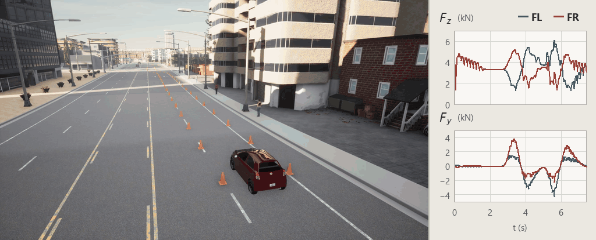

# EViDS

**EViDS: An Environment-Vehicle Dynamics Integrated Simulation Platform for Intelligent Chassis Development**

[English](#english) | [中文](#中文) | [Paper (arXiv)](https://arxiv.org/abs/2611.17660) | [PDF](https://arxiv.org/pdf/2611.17660)
## English

### Overview

EViDS integrates CARLA environment simulation with CarSim vehicle dynamics through MATLAB/Simulink to support the development and evaluation of intelligent chassis algorithms.

CarSim provides the vehicle pose and four-wheel positions. CARLA supplies the virtual environment, and vertical wheel rays return relative ground height (`Z`), friction coefficient (`Mu`), and registered-prop detection flags to Simulink. Height and friction feedback are passed back to CarSim to form the simulation loop.

Main features:

- Vehicle pose and wheel-coordinate mapping between CarSim and CARLA.
- Unified prop registration with configurable friction and height responses; ordinary roads use `Mu = 1`.
- Adaptive ray queries: 10 Hz away from props and 100 Hz near props, with speed-based look-ahead and exit hysteresis.
- Optional semantic, depth, stereo RGB, and LiDAR interfaces, disabled by default.

- 

*Town03 double lane change in CARLA, with synchronized front-wheel vertical loads and lateral forces from CarSim.*

*CARLA Town03 双移线场景，右侧同步显示 CarSim 计算的左右前轮垂向载荷与侧向力。*

### Requirements

| Component | Version |
| --- | --- |
| Operating system | Windows |
| MATLAB / Simulink | R2021b |
| CarSim | 2019.1 |
| CARLA | 0.9.11 |
| Python | 3.7, 64-bit |
| NumPy | 1.21.6 |
| opencv-python | 4.5.5.64 |

Install the Python dependencies in the selected Python environment:

```bash
python -m pip install -r requirements.txt
```

Install the CARLA Python client matching CARLA 0.9.11 and Python 3.7, or provide the path to its external egg file. MATLAB, CarSim, and CARLA must be installed separately.

### Configuration

Edit the values at the top of `evids_test_initialize.m` before opening the model:

| Variable | Description |
| --- | --- |
| `env.PythonExe` | Full path to the 64-bit Python 3.7 executable. |
| `env.CarlaEgg` | Path to the matching CARLA client egg; leave empty if the client is already installed. |
| `env.CarlaExe` | Full path to `CarlaUE4.exe`; may be empty when automatic startup is disabled. |
| `env.CarSimSolvers` | CarSim solver directory containing `Solver_SF.slx` or `Solver_SF.mdl`. |
| `env.CarlaHost` / `env.CarlaPort` | CARLA server address; defaults to `localhost:2000`. |
| `env.AutoStartCarla` | Automatically start the local CARLA server when needed. Set to `false` for a manually started or remote server. |
| `env.StopTime` | Simulation duration in seconds; defaults to `5`. |

Use MATLAB single-quoted strings for paths. The model automatically calls the initialization function during loading and before simulation.

### Run the simulation

1. Set the MATLAB current folder to this repository directory, or add the directory to the MATLAB path.
2. Fill in the installation paths in `evids_test_initialize.m`.
3. Configure the CarSim case with the 12 imports and 14 exports below, in exactly the specified order.
4. Select `EVIDS_core.slx` as the Simulink model in CarSim and click **Send to Simulink**.
5. Click **Run** in Simulink.

CarSim generates its own `simfile.sim` and case files. These must correspond to the selected vehicle, road, and import/export configuration.

### CarSim interface

Wheel order is **L1, R1, L2, R2**: front left, front right, rear left, rear right.

**12 imports — Simulink to CarSim:**

```text
1–4:  IMP_ZGND_L1, IMP_ZGND_R1, IMP_ZGND_L2, IMP_ZGND_R2
5–8:  IMP_MUX_L1,  IMP_MUX_R1,  IMP_MUX_L2,  IMP_MUX_R2
9–12: IMP_MUY_L1,  IMP_MUY_R1,  IMP_MUY_L2,  IMP_MUY_R2
```

The feedback vector is `[Z(1:4); Mu(1:4); Mu(1:4)]`. Use **Replace** mode. `Z` is measured in metres relative to each wheel's initial road baseline; `Mu` is dimensionless and is used for both longitudinal and lateral friction.

**14 exports — CarSim to Simulink:**

```text
1–6:   Xo, Yo, Zcg_TM, Pitch, Roll_E, Yaw
7–10:  Xctc_L1, Yctc_L1, Xctc_R1, Yctc_R1
11–14: Xctc_L2, Yctc_L2, Xctc_R2, Yctc_R2
```

Position units are metres and attitude units are degrees. Use `Zcg_TM` and `Roll_E` as listed. See the [detailed interface and coordinate mapping](docs/CarSim接口.md).

### Props and ray feedback

Configure prop blueprints, spawn transforms, friction coefficients, and height responses in `evids_test_props.m`. The included Town04 example contains a raised prop and a tiled low-friction area.

Static prop geometry is cached after the first CARLA world update. Restart the simulation after moving or deleting registered props externally. Proximity only controls ray frequency; `Mu`, `Z`, and detection flags are determined by actual ray hits.

Road height away from props is also sampled at 10 Hz. Reduce `FarRaycastDt` when finer sampling of ordinary road irregularities is required.

### Files and outputs

| File or directory | Purpose |
| --- | --- |
| `EVIDS_core.slx` | Main simulation model. |
| `EVIDSClosedLoopSensorsV2.m` | CARLA integration, registered props, ray feedback, and sensor interfaces. |
| `evids_test_initialize.m` | User paths and automatic initialization. |
| `evids_test_props.m` | Prop and surface-response configuration. |
| `evids_test_ray_schedule.m` | Adaptive ray-query scheduling. |
| `evids_test_resolve_ray_hits.m` | Height, friction, and detection from ray hits. |
| `python/` | Vehicle-spawning and sensor callback support. |
| `docs/` | Detailed interface documentation. |

Each run saves files under `results/<timestamp>/`, including raw MAT data, wheel-feedback CSV and PNG files, a numerical summary, vehicle-spawn diagnostics, and the cached prop geometry.

### Paper and Citation

If you use EViDS in your research, please cite the following paper.

*EViDS: An Environment–Vehicle Dynamics Integrated Simulation Platform for Intelligent Chassis Development*  
Lu Xiong, Yiming Zhou, Xuge Hu, Yi Zhang, Haoran Lv, and Chen Tang  
Accepted at CEVVE2026. The preprint is available on [arXiv](https://arxiv.org/abs/2611.17660) and as a [PDF](https://arxiv.org/pdf/2611.17660).

```bibtex
@misc{xiong2026evids,
  title         = {{EViDS}: An Environment--Vehicle Dynamics Integrated Simulation Platform for Intelligent Chassis Development},
  author        = {Xiong, Lu and Zhou, Yiming and Hu, Xuge and Zhang, Yi and Lv, Haoran and Tang, Chen},
  year          = {2026},
  eprint        = {2611.17660},
  archivePrefix = {arXiv},
  primaryClass  = {cs.RO},
  url           = {https://arxiv.org/abs/2611.17660}
}
```

---

## 中文

### 项目简介

EViDS 通过 MATLAB/Simulink 连接 CARLA 环境仿真与 CarSim 车辆动力学仿真，支持智能底盘算法的开发与评估。

CarSim 提供车身位姿和四轮位置，CARLA 提供虚拟环境。通过四轮竖直射线获取相对地面高度（`Z`）、附着系数（`Mu`）及已登记道具命中标志，再将高度和附着反馈送回 CarSim，形成仿真闭环。

主要功能：

- CarSim 与 CARLA 之间的车身位姿及四轮坐标映射。
- 统一道具登记，可配置附着系数及高度响应；普通道路默认 `Mu = 1`。
- 自适应射线检测：远离道具时为 10 Hz，接近时为 100 Hz，结合速度提前量与退出滞回进行切换。
- 保留语义、深度、双目 RGB 和激光雷达接口，默认关闭。

### 运行环境

| 组件 | 版本 |
| --- | --- |
| 操作系统 | Windows |
| MATLAB / Simulink | R2021b |
| CarSim | 2019.1 |
| CARLA | 0.9.11 |
| Python | 3.7，64 位 |
| NumPy | 1.21.6 |
| opencv-python | 4.5.5.64 |

在选定的 Python 环境中安装依赖：

```bash
python -m pip install -r requirements.txt
```

安装与 CARLA 0.9.11、Python 3.7 匹配的 CARLA 客户端，或指定外部 egg 文件路径。MATLAB、CarSim 和 CARLA 需自行安装。

### 路径及参数配置

打开模型前，修改 `evids_test_initialize.m` 开头的配置：

| 变量 | 说明 |
| --- | --- |
| `env.PythonExe` | 64 位 Python 3.7 可执行文件的完整路径。 |
| `env.CarlaEgg` | 匹配的 CARLA 客户端 egg 路径；已安装客户端时可留空。 |
| `env.CarlaExe` | `CarlaUE4.exe` 的完整路径；关闭自动启动时可留空。 |
| `env.CarSimSolvers` | 包含 `Solver_SF.slx` 或 `Solver_SF.mdl` 的 CarSim 求解器目录。 |
| `env.CarlaHost` / `env.CarlaPort` | CARLA 服务地址，默认为 `localhost:2000`。 |
| `env.AutoStartCarla` | 需要时自动启动本机 CARLA；自行启动或使用远程服务时设为 `false`。 |
| `env.StopTime` | 仿真时长，单位为秒，默认为 `5`。 |

路径使用 MATLAB 单引号字符串。模型加载和仿真开始前会自动调用初始化函数。

### 运行步骤

1. 将 MATLAB 当前文件夹切换到本仓库目录，或将该目录加入 MATLAB 搜索路径。
2. 在 `evids_test_initialize.m` 中填写自己的安装路径。
3. 在 CarSim 工况中按下述顺序设置 12 个 Import 和 14 个 Export。
4. 将 CarSim 关联的 Simulink 模型设为 `EVIDS_core.slx`，点击 **Send to Simulink**。
5. 在 Simulink 中点击 **Run**。

`simfile.sim` 及相关工况文件由 CarSim 自行生成，必须与所选车辆、道路和输入输出配置对应。

### CarSim 接口

轮序统一为 **L1、R1、L2、R2**，即左前、右前、左后、右后。

**12 个 Import：Simulink → CarSim：**

```text
1–4：  IMP_ZGND_L1, IMP_ZGND_R1, IMP_ZGND_L2, IMP_ZGND_R2
5–8：  IMP_MUX_L1,  IMP_MUX_R1,  IMP_MUX_L2,  IMP_MUX_R2
9–12： IMP_MUY_L1,  IMP_MUY_R1,  IMP_MUY_L2,  IMP_MUY_R2
```

反馈向量为 `[Z(1:4); Mu(1:4); Mu(1:4)]`，采用 **Replace** 模式。`Z` 为相对各轮初始道路基准的高度，单位为米；`Mu` 为无量纲，同时用于纵向和横向附着。

**14 个 Export：CarSim → Simulink：**

```text
1–6：   Xo, Yo, Zcg_TM, Pitch, Roll_E, Yaw
7–10：  Xctc_L1, Yctc_L1, Xctc_R1, Yctc_R1
11–14： Xctc_L2, Yctc_L2, Xctc_R2, Yctc_R2
```

位置单位为米，姿态角单位为度。请按列表使用 `Zcg_TM` 和 `Roll_E`。完整接口与坐标映射见 [详细说明](docs/CarSim接口.md)。

### 道具与射线反馈

在 `evids_test_props.m` 中配置道具蓝图、生成位姿、附着系数和高度响应。随附 Town04 示例包含凸起道具和铺设的低附着区域。

静态道具几何在 CARLA 首帧更新后缓存。若从外部移动或删除已登记道具，应重新开始仿真。距离判断只控制射线频率；`Mu`、`Z` 和命中标志均由实际射线命中决定。

远离道具时，道路高度同样按 10 Hz 采样；若需要更细致地采样普通路面起伏，应缩短 `FarRaycastDt`。

### 主要文件与输出

| 文件或目录 | 用途 |
| --- | --- |
| `EVIDS_core.slx` | 主体仿真模型。 |
| `EVIDSClosedLoopSensorsV2.m` | CARLA 连接、道具登记、射线反馈及传感器接口。 |
| `evids_test_initialize.m` | 本机路径填写及自动初始化。 |
| `evids_test_props.m` | 道具及路面响应配置。 |
| `evids_test_ray_schedule.m` | 自适应射线频率调度。 |
| `evids_test_resolve_ray_hits.m` | 根据射线命中计算高度、附着及命中标志。 |
| `python/` | 车辆生成及传感器回调支持代码。 |
| `docs/` | 详细接口文档。 |

每次运行的结果保存在 `results/<时间戳>/`，包括原始 MAT 数据、四轮反馈 CSV 与 PNG、数值汇总、车辆生成诊断和道具几何快照。

### 引用

### 论文与引用

如果您在研究中使用 EViDS，请引用《EViDS：面向智能底盘开发的环境—车辆动力学一体化仿真平台》。预印本可在 [arXiv](https://arxiv.org/abs/2611.17660) 查看，也可下载 [PDF](https://arxiv.org/pdf/2611.17660)。BibTeX 见[论文引用](#paper-and-citation)。
